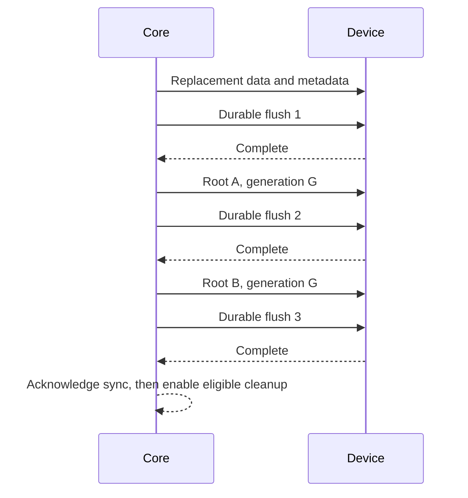

# CarryFS format, revision 1

Every root and every tree and workspace page carries revision 1. An image with
any other revision is rejected as unsupported. The format is not frozen. A
future revision may require copying files out and reformatting.

This document defines the byte representation and the invariants it requires.
It does not establish device durability, bounded cleanup progress at full
capacity, or native filename behavior.

## 1. Encoding, geometry, and limits

Offsets are in bytes from the start of the single partition or image. Block
numbers are relative to that same start. Integers are unsigned little-endian
unless explicitly stated otherwise. Keys use big-endian numeric components so
unsigned bytewise comparison gives the required numeric order. No native Rust
layout, pointers, host endianness, or implicit alignment is persistent.

| Quantity | Value |
|---|---|
| Allocation unit and metadata page | 4,096 bytes |
| Logical data checksum unit | 65,536 bytes, 16 allocation units |
| Logical sector size | 512 or 4,096 bytes |
| Physical sector size | 512 or 4,096 bytes, not smaller than logical size |
| Partition/image length | Multiple of 4,096; 256 MiB through 32 TiB inclusive |
| Maximum logical file size | `2^63 - 1` bytes, including sparse holes |
| Object and cleanup-job identifiers | 1 through `2^63 - 1`; never reused |
| Root object identifier | 1; identifier 0 is invalid |
| Generation | 1 through `2^64 - 1`; never wraps |
| B+tree level | 0 through 7, at most 8 pages on a lookup path |
| Stored name | 1 through 255 UTF-8 bytes after NFC |
| Volume label | 1 through 255 UTF-8 bytes, preserved verbatim; no `/` or control characters; not `.` or `..` |
| Symlink target | 1 through 1,023 UTF-8 bytes, no NUL |
| Folded name | At most 765 UTF-8 bytes |
| Record | At most 3,072 bytes including lengths, key, and value |

Let `N = partition_bytes / 4096`. Reserve blocks `[0, 512)` and `[N-512, N)`.
Root A occupies block 256; root B occupies block `N-257`. The two 2 MiB reserved
bands contain no ordinary data or metadata. Workspace banks occupy `[32,96)`
and `[N-96,N-32)` inside them. Each bank uses at most 51 pages; its root is its
first page. Reserved bands must be zero before formatting. There is no separate superblock or third commit pointer.
This document does not define partition-table discovery or type identifiers.

Block I/O uses sector-aligned offsets, whole sectors, checked multiplication
and checked end offsets. Unsupported geometry is an error. A short read of any
required record is an I/O error, not zero-filled metadata. Device adapters must
complete exact reads/writes or report failure; zero progress cannot loop forever.
A direct-I/O backend supplies its own memory-aligned buffers; the in-memory page
type is not over-aligned.

Reserved fields and unused page bytes must be zero. Unknown record kinds, flags,
revisions, or feature bits are rejected, including on read-only opens. Validate
lengths before slicing, converting to host sizes, or allocating. No allocation
may be sized directly from an unchecked disk count.

## 2. Checksums and references

CRC32C uses polynomial `0x1EDC6F41`, reflected polynomial `0x82F63B78`, initial
state `0xFFFFFFFF`, reflected input/output, final XOR `0xFFFFFFFF`. Store the
resulting unsigned 32-bit number little-endian. Empty input yields `00000000`;
ASCII `123456789` yields `E3069283`. CRC detects accidental damage; it is not
authentication. [CRC32C reference and vectors](https://www.rfc-editor.org/rfc/rfc3720#appendix-B.4).
The revision implies CRC32C; no record carries an algorithm identifier, so a
different checksum algorithm would need a new revision.

A `TreeRef` is 16 bytes: block number `u64` followed by expected birth generation
`u64`. Both are nonzero. The referenced page must have exactly that block number,
generation, volume UUID, tree kind, and expected level. A child's generation may
be older than its parent, but must not be newer. Root references may be older
than the selected root generation. A reference does not imply a new copy of an
unchanged page.

No cycle or repeated page reference is permitted within the selected forest of
live and detached trees. No live extent may overlap another owner, metadata,
reserved bands, workspace slots, or retired blocks. A checker must detect repeated references;
it may use bounded-memory external sorting to avoid a volume-sized RAM bitmap.

## 3. Current-root record

Each root occupies one complete page. CRC covers all 4,096 bytes with bytes
4092 through 4095 treated as zero. Its physical identity is part of the CRC.

| Offset | Bytes | Field and validity |
|---:|---:|---|
| 0 | 8 | ASCII `CFSXROOT` |
| 8 | 4 | Root revision, 1 |
| 12 | 4 | Record bytes, 4,096 |
| 16 | 4 | Allocation bytes, 4,096 |
| 20 | 4 | Checksum-unit bytes, 65,536 |
| 24 | 16 | Nonzero volume UUID, opaque bytes in RFC UUID byte order |
| 40 | 8 | Self block, exactly the location being read |
| 48 | 8 | Generation |
| 56 | 8 | Device blocks, exactly `N` |
| 64 | 16 | Catalog `TreeRef` |
| 80 | 16 | Allocation `TreeRef` |
| 96 | 16 | Cleanup `TreeRef` |
| 112 | 8 | Next object ID, greater than every issued ID |
| 120 | 8 | Free blocks, including the maintenance reserve |
| 128 | 8 | Feature bits, zero |
| 136 | 4 | Filename profile, 2 |
| 140 | 4 | State flags, zero |
| 144 | 8 | Maintenance reserve floor, 16,384 blocks |
| 152 | 8 | Next cleanup-job ID, greater than every issued job ID |
| 160 | 16 | Workspace bank `TreeRef`; block 32 or `N-96` |
| 176 | 8 | Next allocation group to scan for workspace refill; less than `ceil(N/16384)` |
| 184 | 2 | UTF-8 label byte length, 0 through 255; 0 means the volume is unnamed |
| 186 | 255 | Label bytes followed by zeros; all zero when unnamed |
| 441 | 3,651 | Reserved zero |
| 4092 | 4 | CRC32C |

ID allocation fails before the next-ID field would overflow its allowed range.
Consequently the maximum ID is an exhaustion sentinel, not an issuable ID.
Generation exhaustion disables further publication. There is no wrap comparison.
The UUID changes on every format, preventing accidental cross-volume references.
The label participates in the root CRC and same-generation mirror comparison.
Naming or renaming publishes both roots using the normal commit sequence and
does not change the UUID, allocation accounting, or page encodings.

### Selection and reopen

1. Obtain exclusive device ownership for writable open. A read-only inspection
   also requires stable bytes, either an exclusive reader or an immutable copy.
   Never inspect a changing mounted image and claim a coherent result.
2. Read A and B at positions derived from verified device geometry. Validate
   their envelopes, CRCs, self locations, and geometry before trusting fields.
   An I/O failure is not interchangeable with a checksum-invalid root: if either
   read fails, opening fails because that slot may contain the newer state.
3. A checksum-valid envelope advertising an unsupported revision/profile/features
   produces `UnsupportedFormat`, not fallback to an older compatible root.
4. If neither supported root is valid, report corruption. If both are valid but
   UUIDs differ, report corruption. At equal generation, all bytes other than
   self block and CRC must match exactly; otherwise report corruption.
5. Select the highest valid root generation. Only then validate referenced
   pages. Damage in its trees must not cause selection of an older generation.
6. For writable open, before allocation, mutation, or reclamation, copy the
   selected state into any invalid/older root slot, encode that slot's identity,
   and durably flush it. Mirroring is idempotent and does not advance generation.
   A repair write/flush error fails open. Read-only open never mirrors anything.

Root CRC failure can permit use of the other root, as specified above. This is
distinct from historical rollback after a selected tree or data checksum fails.
A post-sync media-corruption event can defeat both root copies; CRCs do not
promise redundancy for all data.

### Publication and crash states

The core serializes operations. It seals a complete transaction before the first
write. Replacement metadata comes from available workspace slots in the
previously mirrored state. Their contents are opaque. Replacement file data
comes from that state's raw free bitmap. The inactive workspace bank is written
with the replacement pages whenever its slot list changes. Neither the active
bank nor newly superseded metadata can be overwritten by that transaction.
No root is issued until all replacement data and metadata writes have completed
and their durable flush has succeeded.



| Interruption | Reopen rule |
|---|---|
| Replacement writes or first flush | Old mirrored roots; new unreachable writes are abandoned |
| A write or its flush | Either valid old roots or valid G; choose highest valid envelope |
| B write or its flush | G is durable in A; select G and finish mirroring |
| After final successful flush | Both roots contain G; synchronized state is durable |
| Later commits after acknowledged G | Recovery may select G or a later committed state |

A failed write or flush during transaction output faults the instance. It must
not retry publication, continue mutation, or reclaim any block. An error does
not establish which writes reached durable storage. Reopen is required even if
the last failed operation might have committed. Dropping a volume does not sync.

A durable flush means all earlier writes reached persistent media and cannot be
reordered after subsequent writes on a device that honors that command. A host
buffer-cache flush alone is insufficient. Each adapter must establish its
command and ordering on real media.

### Formatting an image

Formatting is an explicit destructive operation, separate from open. The
formatter requires a writable exclusive device and both reserved
bands, including the root slots, to be all zero before starting. Checking these
4 MiB enforces section 1's initial-zero rule without adding format-time writes.
A recognizable or partially written root is
rejected as an existing/unfinished format; clearing it requires a separate
explicit reformat decision. This avoids mixing a new UUID with an old root.

There is no prior allocation map during bootstrap. Derive the initial map from
geometry: reserved bands, metadata blocks 512 through 514, and workspace slots
8192 through 16383 have set allocation bits. Write a
catalog leaf at 512 containing only root inode 1, an allocation leaf at 513
containing the group-0 bitmap, and an empty cleanup leaf at 514. Omitted groups
use the implicit bitmap rule below. Encode the 8192-slot workspace list in bank
32, also born in generation 1. All three ordinary pages are born in generation 1.
Root inode is an empty directory with parent 1 and timestamps supplied at format
time. Both roots specify next object 2, next job 1, workspace `(32,1)`, scan
cursor 0, and `free = N - 1024 - 3`. This count includes the workspace slots.

Write the initial forest, durable flush, A generation 1, durable flush, B
generation 1, durable flush, then report success. A failed format is never
reported as successful. If it nevertheless left one valid generation-1 root,
ordinary open may recover that complete empty filesystem and finish mirroring.
With no valid root it is unfinished media requiring explicit reformatting.
This bootstrap exception does not permit later allocations without a mirrored
free map.

## 4. One B+tree page format

Use one page encoding for catalog, allocation, cleanup, and workspace trees.
Catalog, allocation, cleanup, and detached catalog trees use the COW tree editor.
The workspace list is packed directly into its fixed bank. These are private
storage details.

| Offset | Bytes | Field |
|---:|---:|---|
| 0 | 8 | ASCII `CFSXPAGE` |
| 8 | 2 | Revision, 1 |
| 10 | 2 | Flags, zero |
| 12 | 1 | Page kind: 1 leaf, 2 internal |
| 13 | 1 | Tree kind: 1 catalog, 2 allocation, 3 cleanup, 4 workspace |
| 14 | 1 | Level; leaf 0, internal 1 through 7 |
| 15 | 1 | Reserved zero |
| 16 | 8 | Self block |
| 24 | 8 | Birth generation |
| 32 | 2 | Entry count |
| 34 | 2 | Payload bytes used, at most 4,016 |
| 36 | 4 | Reserved zero |
| 40 | 16 | Volume UUID |
| 56 | 8 | Subtree data-block total |
| 64 | 4 | CRC32C of entire page with this field zero |
| 68 | 12 | Reserved zero |
| 80 | 4,016 | Packed records then zero padding |

Each record is `key_bytes:u16, value_bytes:u16, key, value` with no padding.
Its total size is at most 3,072; key length is 1 through 1,024. Counts must
consume exactly `payload_bytes`; duplicates and non-increasing keys are errors.
Padding is checked independently of the CRC.

Leaves contain the records below. Internal values are exactly one `TreeRef`.
Each internal key is the minimum key of that entire child subtree. There is one
entry per child, no special leftmost pointer, no sibling links, and no prefix
compression. Child ranges are disjoint and ordered. Every child level is one
less than its parent. A nonempty root may be a leaf; an empty tree is a zero-entry
leaf root. Empty non-root pages and one-child internal roots are invalid.
Non-root internal pages have at least two children. There is no minimum leaf
fill percentage.

For catalog leaves, subtree data-block total is the checked sum of extent
record block counts on the page; all other record kinds contribute zero. For
catalog internal pages it is the checked sum of child subtree totals. It is
zero for allocation, cleanup, and workspace pages. The aggregate is covered by the page CRC.
Validate leaf sums when decoding and parent/child sums when checking or
rebuilding a node. A range split carries these totals through its boundary
paths. Truncate can then subtract the detached allocation total from the inode
without scanning every sparse extent. Totals do not replace ownership checks
or authorize freeing blocks without reading the actual extent records.

All updates are COW. In addition to lookup/insert/remove, the tree supports
splitting by key range and joining disjoint ordered trees. A range detach copies
only boundary paths and returns a separate tree root; it must not enumerate the
entire detached range. The selected catalog and detached trees must not share
pages. Old boundary pages are retired normally.

## 5. Catalog records

Keys start with `owner:u64 BE, kind:u8`. Grouping by object makes all records for
one object a detachable interval. Only the specified suffixes are valid.

| Kind | Suffix | Value |
|---:|---|---|
| 1 | None | 128-byte inode; a symlink's target follows it |
| 2 | Folded UTF-8 name bytes | Directory entry |
| 3 | Logical starting block `u64 BE` | 16-byte extent |
| 4 | Checksum group index `u64 BE` | 36- to 1,056-byte checksum group |

### Inode

| Offset | Bytes | Field |
|---:|---:|---|
| 0 | 1 | Object type: 1 regular file, 2 directory, 3 symbolic link |
| 1 | 1 | Flags: bit 0 orphan; on symlinks only, bit 1 link kind recorded and bit 2 directory link; other bits zero |
| 2 | 6 | Reserved zero |
| 8 | 8 | Parent object ID; root refers to itself |
| 16 | 8 | Logical file size; zero for directories; target length for symlinks |
| 24 | 8 | Allocated data blocks in the object's current extents |
| 32 | 8 | Directory child count; zero for files |
| 40 | 16 | Creation timestamp |
| 56 | 16 | Modification timestamp |
| 72 | 16 | Metadata-change timestamp |
| 88 | 40 | Reserved zero |
| 128 | size | Symlink target; present only for type 3 |

A file or directory inode is exactly 128 bytes. A symlink inode is 128 bytes
plus its target, so its value length is `128 + size`. The target is 1 through
1,023 bytes of UTF-8 with no NUL, stored verbatim with `/` separators and never
normalized or resolved by CarryFS; the host resolves it. 1,023 is macOS
`MAXPATHLEN` less its terminator, so a target written on any adapter reads on
all three. Keeping the target in the inode record means attributes and the
target cost one lookup and the object stays one kind-1 record, so removal and
cleanup treat it like an empty file. A symlink has allocated blocks 0, child
count 0, and no entries, extents, or checksum groups under its owner.
Flag bits 1 and 2 record the kind of a link Windows created: bit 1 set means
recorded, and bit 2 then means a directory link; bit 2 without bit 1 is
invalid. Windows keeps directory and file links apart whatever the target is,
and creates a directory link as a directory first, so a conversion records
which object it started from. Links made elsewhere leave both bits clear. The
Linux and macOS adapters ignore them.

Each timestamp is signed Unix seconds `i64`, nanoseconds `u32`, reserved zero
`u32`. Seconds range from -11644473600 through 253402300799, corresponding to
1601 through 9999; nanoseconds range from 0 through 999999999. These are UTC
instants, not local times. Windows conversion may truncate nanoseconds to its
100 ns resolution. An adapter must not change stored timestamps merely on read.

Root is a linked directory and never orphaned. Each other linked inode has
exactly one directory entry, matching its parent. Files have no directory-entry
children, directories and symlinks have no extents/checksum groups, and the linked directory
graph is rooted and acyclic. Orphans have no directory entries and exactly one
orphan marker in the cleanup tree. Their last parent is retained for attributes
and may itself have been removed; it is not a liveness reference.

### Directory entry

Value layout: target object `u64` at 0; type `u8` at 8; reserved zero `u8` at 9;
stored-name length `u16` at 10; stored NFC UTF-8 bytes at 12. There are no trailing
bytes. The name must recompute to the key's folded suffix. Type agrees with the
target inode (1 file, 2 directory, 3 symlink). Case-only rename updates stored
spelling in this same key.

Create, rename, replacement, and removal publish all affected entries, inodes,
parent child counts, and timestamps atomically in one transaction. Rename
replacement accepts non-directory-for-non-directory or directory-for-empty-directory. It rejects
nonempty destination directories and moving a directory into itself or a
descendant. Renaming an object to its own key is either a spelling update or a
no-op, not unlink/recreate. A failure before transaction output changes neither
namespace nor visible in-memory state.

A symlink replaces or is replaced by a regular file like another file: rename
replacement accepts any non-directory for a non-directory. Unlink removes a
symlink, never its target. An empty regular file or empty directory may be
converted in place into a symlink in one transaction that rewrites its inode and
entry type; the Windows adapter needs this because Windows creates a link as a
new object and then sets its reparse point.

### Extent

Value: physical starting block `u64`, block count `u32`, reserved zero `u32`.
Count is nonzero. Logical and physical ends use checked arithmetic. Extents are
ordered, nonoverlapping, in range, and uniquely own their data blocks.

Sparse allocation has 64 KiB granularity. Each logical checksum unit is either
entirely a hole or entirely backed for its valid bytes. Backed units need 16
blocks except the last file unit, which needs `ceil(valid_bytes/4096)`. An
allocated unit may use multiple physically fragmented extents. Each physical
block still holds exactly the corresponding logical 4 KiB slice. Adjacent
logical/physical runs may be coalesced up to the `u32` count limit.

No extent lies past `ceil(file_size/4096)`. Bytes beyond EOF in the last allocated
block are zero. Missing blocks inside a backed unit, overlapping extents, and
nonzero padding past EOF are corruption. Holes within the same checksum unit as
a write are materialized as zero bytes when that unit becomes backed.

### Packed checksum group

One group represents 256 consecutive checksum units, or 16 MiB of logical file
space. The key suffix is `unit_index / 256`. Bytes 0 through 31 are a presence
bitmap, least-significant bit first within each byte. Bytes 32 onward are
little-endian CRC32C values for slots 0 through the last present slot, and the
value ends there: a group whose last present slot is `n - 1` is `32 + 4n`
bytes, 36 through 1,056. Slot `unit_index % 256` has bit 1 exactly when that
logical unit is backed by extents. Hole slots below the last present slot have
bit 0 and CRC zero; bitmap bits at or above the stored length are zero. CRC
zero is also a valid result for a present slot. Entirely empty groups are
omitted. Slots beyond EOF are absent. Any other length or layout is corrupt,
so each group has exactly one encoding. A file of at most one unit stores a
36-byte group.

For each backed unit, checksum this exact concatenation:

```text
ASCII "CFSXDATA"                 8 bytes
volume UUID                     16 bytes
object ID, little-endian u64      8 bytes
logical unit index, LE u64        8 bytes
valid byte count, LE u32          4 bytes
unit data, zero-padded to 65536 65536 bytes
```

`valid = min(65536, file_size - unit_index*65536)` and is in 1 through 65536.
Every byte after `valid` in the checksum input is zero. For holes, the verified
metadata establishes the zero contents; there is no physical read or data CRC.
The checksum binds logical identity and EOF length, but not physical placement.

### Read, write, and truncate rules

- Read verifies all valid bytes of each affected backed checksum unit before
  exposing bytes from that unit. Reading one byte can require a 64 KiB read.
  Report missing checksums and damaged data; do not substitute zeros.
- A partial overwrite verifies the old affected unit, overlays new bytes, zeros
  tail padding, and replaces extents/checksum slots. It retains verified,
  mapped 4 KiB blocks wholly outside the changed range and both valid lengths
  when the resulting unit has at most four extent runs. Other blocks get new
  storage; if the run limit would be exceeded, the whole unit is replaced.
  A full overwrite of all old valid bytes may replace unreadable contents
  without first reading those bytes, provided the mapping metadata is valid.
- Growing a file creates holes. If growth changes the old backed tail unit's
  valid length, verify it and rewrite its padded representation and checksum.
  Old discarded data can never become visible after growth.
- Shrink verifies and COW-rewrites any retained partial backed unit. Whole units
  removed from the visible mapping are detached immediately. Update EOF, extent
  boundaries, the partial checksum group, and cleanup jobs in one transaction.
  A checksum failure in the retained partial unit fails truncate without change.
  No read of completely discarded data is required.
- A zero-length write changes no attributes. Successful content/size changes
  update modification and metadata-change times; creation time is preserved.
  Namespace changes update affected parent modification/metadata-change times
  and the renamed/unlinked object's metadata-change time. Access times are not
  stored. Explicit creation/modification-time setters update metadata-change time.

## 6. Allocation and bounded cleanup

An allocation group covers 16,384 blocks, or 64 MiB. Allocation-tree keys are
exactly the group index `u64 BE`; values are exactly 2,048 bitmap bytes. Bit
`block % 16384`, least-significant bit first, is 1 for unavailable storage.
Bits outside the volume in a partial final group are 1. Reserved-band bits are
always 1. Absent group records mean all valid nonreserved blocks are free and
all reserved/out-of-volume bits are 1. A group whose bits equal this implicit
value may be omitted initially. The planner retains records after insertion,
including when their bits become implicit, to preserve the topology bound for
workspace balance. This allows sparse images without eager bitmap I/O.

The bitmap accounts for live tree pages, detached-tree pages and data, active
file data, retired blocks, and available workspace slots. Each nonreserved set
bit has exactly one owner. Root free count equals raw zero bits plus the number
of workspace slots. It excludes live and retired storage. A structural checker
reconciles all owners and allocation; it never fixes the map.

### Protected metadata workspace

A workspace leaf record is a run: an eight-byte first-block key (`u64 BE`) and
a four-byte slot count (`u32 LE`, at least 1). A run lies wholly inside the
nonreserved region. Runs leave at least one block between them, so a given list
has exactly one encoding. The slots a bank lists are therefore strictly
increasing, nonreserved, unique, and allocated in the bitmap. Live metadata is
absent from the list. A bank holds at most 12500 slots. At most 250 runs use a
leaf root. Larger lists use a level-1 root followed by sequential leaves, each
with 250 records except the last, which has 1 through 250. There are at most 50
leaves and 51 pages total. A contiguous list of any size is one run and one
page, which is what the planner's list normally is.
Internal references have the same generation as the bank root, point to
`bank_start + 1 + child_index`, and have the exact child minimum key. Normal
metadata references cannot point into either reserved bank.

The current-root record selects the bank explicitly; generation parity does
not select it. An unchanged list retains its old reference. A changed list uses
the other bank at the new generation. Every referenced page must be supplied
before the first publication flush. Writable reopen checks the selected list
and all ownership before completing root mirroring. No bank or slot reuse is
permitted until that mirroring has durably completed.

A transaction assigns metadata drafts from the base slot list, excluding slots
it will release. It returns superseded metadata pages to the successor list.
Both kinds of block keep their allocation bits set. Newly returned slots cannot
fund the transaction returning them. The list needs no allocation-tree entry
for its own bank pages because those pages are already reserved.

The current planner aims for 8192 available slots. Below 8064 it refills when at
least 128 raw free blocks exist; above 8320 it releases 128 unused base slots.
Refill scans at most 128 groups, takes at most 128 free blocks, and advances a
persistent group cursor. A scan that finds nothing can publish only the cursor,
retaining all tree and bank references. Balance operations retain bitmap records.
The complete successor list must fit 12500 entries and contain at least 4096
slots. These exact admission checks establish ownership and bounded failure;
foreground deletion credits remain a separate proof obligation below.

### Cleanup-tree records

| Prefix and key suffix | Value |
|---|---|
| `1:u8, retirement_generation:u64 BE, first_block:u64 BE` | Block count `u32`, reserved zero `u32` |
| `2:u8, job_id:u64 BE` | Detached-tree job, 32 bytes below |
| `3:u8, orphan_object_id:u64 BE` | Empty |

A detached job stores owner ID `u64` at 0, lowest catalog kind `u8` at 8,
highest catalog kind `u8` at 9, six zero bytes at 10, and catalog `TreeRef` at
16. Kinds are an inclusive interval within 1 through 4. Every retained record
has that owner and an allowed kind. A job is the sole owner of its detached
tree and data extents. Detached checksums/inodes describe removed state and need
not match a current inode or EOF. They are not sources of user-visible data.

Data COW replacement adds superseded data to retirement records in generation G.
It remains allocated and disjoint from live, detached, and workspace ownership.
Retirement generations cannot exceed the containing root generation. After both
roots durably contain at least G, a later transaction can remove/split those
records and clear the corresponding allocation bits. Newly retired data is never
a destination of the transaction retiring it. Retired ranges are disjoint and
bounded by geometry. Superseded metadata returns to the next workspace list
instead of entering the retirement tree.

Planning assigns primary catalog/job drafts from base workspace slots, encodes
job references, edits cleanup and affected bitmap groups, then assigns the
remaining drafts. Metadata replacement changes no bitmap bits, so there is no
allocator/cleanup retry loop. Seal checks output and retired-page counts, the
successor workspace, and free accounting before encoding all output. A failed
plan issues no writes. No bitmap or live tree page is updated in place.

Large deletion and truncation detach ranges, rather than walking all their
extents in the initiating operation. A cleanup batch consumes the first records
of a detached tree through ordinary COW updates. For a long extent, retire a
bounded physical prefix and advance its logical/physical start and count in the
same transaction. Consuming metadata returns the corresponding pages to the
successor workspace. Delete an empty job and return its empty root atomically. A crash either retains the
old job or the advanced job; it never loses ownership of its remaining blocks.

Unlink of an object no handle pins, with fewer than 32 catalog records and at
most 512 data blocks (no more than one job step drains), removes its records
and retires its extents in the unlink transaction; it never becomes an orphan.
Otherwise unlink sets the inode's orphan flag and adds an orphan marker. Open
handles pin that inode, including directory handles. Last close permits
removing the object and its marker: a small object loses its records and
retires its extents in the transaction that removes the marker, and a larger
one has its catalog interval detached into a job. All handles cease
to exist on process death, so reopen can process orphan markers incrementally.
A replacement rename uses this same path for an open destination object.

### Work budgets

| Work | Initial ceiling |
|---|---|
| File bytes accepted by one write call | 1 MiB; caller loops over short writes |
| Dirty file data retained | 4 MiB |
| Replacement ordinary metadata in one publication | 4,096 pages, 16 MiB |
| Superseded ordinary metadata per publication | 4,096 pages |
| Workspace bank output per publication | At most 51 additional pages |
| Draft nodes created per transaction, including discarded drafts | 4,096 |
| Metadata page reads per transaction | 1,048,576, plus at most 51 workspace pages |
| Workspace balance | At most 128 groups scanned and 128 blocks transferred |
| Clean metadata cache | 32 MiB, including cached allocation pages |
| Directory page returned to caller | 64 entries |
| Open handles | 4,096 per volume |
| Cleanup batch | At most 64 records and 1,024 data blocks |
| Maintenance headroom | 16,384 free blocks, 64 MiB |

These are explicit initial implementation limits, not measured optimal values.
Buffers and work queues must have additional fixed bounds, not scale with volume
size. An adapter can combine short core transfers while preserving error results.
The core may sync earlier to stay within the dirty-data budget. Sync publishes
pending user changes; it need not drain the entire cleanup backlog.

The planner has no accounting retries. Cumulative draft/read limits and the
refill scan cursor bound each transaction even when no raw free block is found.
A fixed-width bitmap replacement copies at most eight pages and returns the
same number of superseded pages. Inserting one bitmap grows the tree by at most
the old path length plus one. These bounds support workspace refill; they do not
prove every catalog deletion or open-handle lifetime can be admitted safely.

Foreground allocation must leave maintenance headroom after charging its maximum
publication cost and partial-tail rewrites. Report `available = max(free - 16384,
0)` to users. Cleanup and space-reducing mutations may spend the reserve. Before
doing so, account for the live reserve held across publication/mirroring and the
next reclamation step. No successful foreground operation may consume that
required budget. Returning all newly retired blocks to users prematurely is
forbidden.

The foreground reserve and successor workspace floor are implementation limits,
not a complete proof of full-disk progress under deletion credits,
variable-length separator growth, detached cleanup, and sustained
refill/release. The workspace mechanism does not change two-root publication
ordering.

## 7. Filename profile 2

The tables come from Unicode 16.0.0. The format is not frozen, so the profile
may still change.

At the input boundary, limit raw encoded input to 1,024 bytes, decode strict
UTF-8, reject unassigned Unicode 16.0 code
points, surrogates, and general-category `Cc` controls, then normalize to NFC.
Also reject empty names, `.` and `..`, and ASCII `/`. Enforce 255 stored UTF-8
bytes and 765 folded bytes. A NUL or control is already disallowed above.
Private-use characters are allowed; unpaired UTF-16 surrogates from Windows are
invalid input. No truncation or replacement characters are inserted.

Comparison key: `UTF8(NFC(full_default_case_fold(NFC(name))))`. Use mappings
marked C or F in the Unicode 16.0.0 CaseFolding file; ignore S and Turkic T mappings.
This is locale-independent full folding, not platform lowercasing, NFKC, or
removal of default-ignorable characters. Keep original NFC capitalization in
the directory entry. [Case folding data](https://www.unicode.org/Public/16.0.0/ucd/CaseFolding.txt),
[Unicode normalization](https://www.unicode.org/reports/tr15/).

The stored name is the original NFC spelling. macOS and Linux expose it directly.
The Windows adapter gives forbidden names a reversible alias. Forbidden ASCII
punctuation, a trailing space, and a trailing period become the private-use
characters U+F020 to U+F029 from the Services for Macintosh table, which Samba
and the macOS SMB client also use. A reserved device name's first ASCII character
becomes fullwidth. U+E000 escapes an original U+E000, U+E001, U+F020 to U+F029,
or a fullwidth first character that would otherwise read as a device name.
U+E001 prefixes a reserved device name whose first character is non-ASCII.
Windows decodes an alias before catalog lookup and accepts only the spelling
the encoder produces, before NFC normalization; it needs no directory scan or second index. Every alias
fits 255 UTF-16 units because substitutions keep one unit per ASCII byte and
escaped three-byte characters use two units. Windows creation accepts aliases
and stores their decoded names. Symlink path components
use the same translation. `windows/src/fs.rs` implements the exact mapping.
[Windows naming rules](https://learn.microsoft.com/en-us/windows/win32/fileio/naming-a-file).

On-disk names must already be valid NFC with the correct comparison key.
Malformed disk names produce corruption, not automatic normalization/repair.
Names collide exactly when their folded byte keys match within one directory.
Adapters must use this core result rather than their host OS comparison APIs.

Examples: `Straße` collides with `STRASSE`; `é` collides with `e` plus combining
acute; Greek final sigma collides with sigma. `I` collides with `i`, while dotless
`ı` remains distinct and `İ` folds to `i` plus combining dot. Fullwidth letters
remain distinct from ASCII letters.

## 8. Errors, checking, and extraction

| Condition | Required result |
|---|---|
| Invalid request, name, type, collision, missing entry | Typed request error; no mutation for that operation |
| Budget exhausted before output | NoSpace/Limit error; no partial namespace operation |
| Unsupported envelope/version/feature | UnsupportedFormat; no writes |
| Malformed metadata or checksum mismatch | Corruption with object/block/unit context |
| I/O error during output or mirroring | Faulted instance; no further mutation/reclamation |
| Corruption discovered on a writable volume | Fault mutation/reclamation; allow only independently verified reads |
| Failed sync/eject | Return error; never report safe removal |

A read-only structural check validates root selection, tree identity/order,
references, record schemas, names, directory graph, extent bounds, checksum
presence, orphan/jobs/retirement accounting, and allocation agreement. Scrub
additionally reads all backed file units, including live orphan files, and
verifies data CRCs. Neither operation modifies the source or silently falls
back. Reads of required metadata failing do not justify reconstructing facts
from an older root.

Extraction writes to a distinct destination and records every unreadable object
or range. It never overwrites a destination silently or reports zero-filled
damaged ranges as recovered data. Holes in verified source mappings may remain
sparse. A missing parent or unreadable subtree limits enumeration and is itself
reported. No in-place repair, snapshot recovery, or historical rollback is
promised.

## 9. Test vectors and reference checks

`testdata/vectors/` holds standalone root and page encodings.
`testdata/checksum-vectors.json` lists their CRCs and the data-unit checksum
cases. They are byte-layout fixtures, not mountable volumes.
`testdata/name-vectors.json` holds filename cases with their stored names and
comparison keys.

`spec/verify.py` is a Python implementation of the encodings and the filename
profile, separate from the Rust code. It rebuilds each fixture and compares it
with the file, checks the CRCs, and runs the Unicode normalization tests and
the filename cases:

```sh
python3 spec/verify.py
python3 spec/verify.py --write
```

`--write` regenerates the fixtures. Change the layout here and in `verify.py`
first, then review the regenerated files as a diff.

`testdata/unicode/16.0.0/` holds the Unicode 16.0.0 source files with their
license. `manifest.json` pins the length and SHA-256 of each, and `verify.py`
fails when one changes. `spec/generate_name_tables.py` writes
`src/name_tables.rs` from them.
