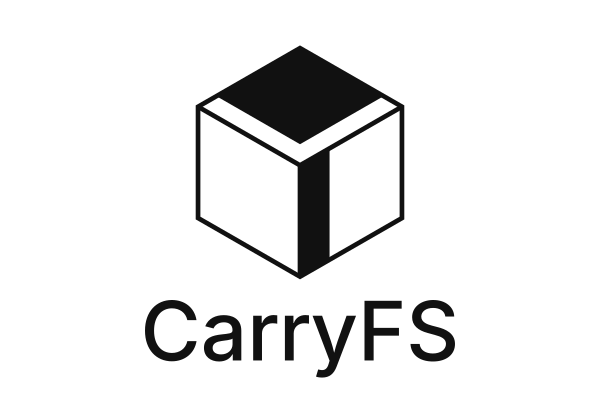
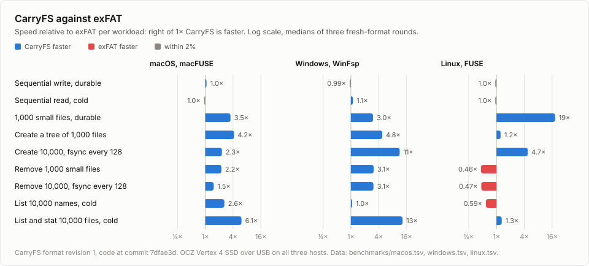

<h1 align="center">
  <picture>
    <source media="(prefers-color-scheme: dark)" srcset="assets/logo-dark.svg">
    
  </picture>
</h1>

<b>Your files, across macOS, Linux, and Windows.</b>

  
  
  
  

CarryFS is an open-source filesystem for sharing data across operating systems,
with copy-on-write storage and built-in checksums.

## Why CarryFS exists

I use a MacBook, a Windows PC, and Linux. Sharing a drive often means choosing
a filesystem for one platform, then finding extra software to use it on the
others. Some of that software is paid.

exFAT works across platforms, but it doesn't checksum file contents. A file
can still open even when its bytes have been silently damaged.

I wanted to share the same data drive across my machines and be confident that
my files remain in a consistent state. I also wanted one drive that could hold
backups from all of them.

## Built for your data

CarryFS is for USB drives, external SSDs and hard disks, or an internal data
partition shared in a dual-boot setup.

I'm keeping CarryFS focused on sharing data between systems. It doesn't need
to do everything an operating-system filesystem does. Booting an operating
system and server workloads are outside its scope.

If you use only one operating system, its native filesystem may already meet
your needs.

## Consistency and integrity

CarryFS uses copy-on-write for file data and metadata. When you update a file
or rename a directory, it writes replacement blocks before publishing the new
state. The previous committed state stays intact during that process, provided
the device honors flushes. Changes that have not been synchronized can still
be lost after an interruption.

Checksums detect accidental corruption. If part of a photo or backup archive
becomes corrupted, CarryFS reports the damage rather than silently returning
those bytes. Its scrub tool lets you verify stored files before you need them.

Copy-on-write does not recover damaged files, and checksums do not repair them.
CarryFS has no self-healing. Automatic repair needs extra copies or parity,
which consumes storage and can add processing and I/O costs. Restore damaged
files from an independent backup.

## How it works

CarryFS has a shared Rust engine. It runs in user space through
[Linux FUSE](https://github.com/libfuse/libfuse),
[macFUSE](https://macfuse.github.io/) on macOS, and
[WinFsp](https://winfsp.dev/) on Windows. You need the matching framework
installed to mount a volume.

I chose these frameworks so I could focus on the filesystem itself instead of
maintaining three kernel drivers across OS versions.

macFUSE and WinFsp already provide signed drivers. Reusing them avoids the
[Apple developer membership](https://developer.apple.com/programs/enroll/) and
[Windows driver-signing certificate](https://learn.microsoft.com/en-us/windows-hardware/drivers/dashboard/code-signing-reqs)
costs of distributing my own kernel drivers.

CarryFS supports files, directories, and symbolic links. It includes tools for
checking filesystem structure and extracting files.

Filenames preserve their capitalization but are case-insensitive. `File.txt`
and `file.txt` cannot coexist in the same directory. CarryFS keeps names that
Windows normally forbids, such as `CON`, `NUL`, `COM1`, names containing `:` or
`?`, and names ending in a space or period. On Windows, CarryFS presents these
names using Windows-compatible aliases while keeping the stored names
unchanged. macOS and Linux show the stored names.

Encryption, compression, snapshots, deduplication, RAID, and hard links are
outside the current scope. CarryFS does not preserve platform-specific
permissions, ACLs, extended attributes, resource forks, or alternate data
streams. Copying a directory tree is not a complete system backup. You can
store a metadata-preserving backup archive as an ordinary file.

## Performance

FUSE, macFUSE, and WinFsp add a layer between applications and the filesystem
engine. That extra work can make it hard to match or beat native filesystems.

I've tested CarryFS on SSDs and HDDs. My focus is the files you move between
machines: photos, videos, PDFs, source files, and backup archives. The results
surprised me. On my hardware, CarryFS is usable for everyday file storage, and
some operations in my benchmarks complete faster than on exFAT, a common choice
for sharing drives across macOS, Linux, and Windows.

<picture>
  <source media="(prefers-color-scheme: dark)" srcset="benchmarks/charts/vs-exfat-dark.svg">
  
</picture>

The chart shows medians of three rounds on an OCZ Vertex 4 SSD connected over
USB. The [benchmark notes](benchmarks/README.md#published-results) have a chart
for each host with ext4, Btrfs, NTFS, and APFS, the method, and the raw
results.

There's always the "you measured it wrong" joke with benchmarks. These results
come from my hardware and workloads. I haven't tested on high-end NVMe drives
yet. Try CarryFS on your own drives and share your results.

## Current status

CarryFS is in **public beta**.

I use CarryFS myself, and I'm publishing the source after more than 15
iterations of development. I'm happy with the current design and don't plan to
change the disk format without a good reason.

The format isn't frozen yet. I expect most updates to be fixes and improvements
to the platform adapters, but a future format change may require copying your
files elsewhere and reformatting the partition.

Use replaceable data when testing. Keep independent backups and never put the
only copy of important data on CarryFS. The 3-2-1 rule still applies: three
copies, on two types of media, with one copy offsite. Checksums verify stored
bytes, but do not prove that a backup is complete or restorable.

I need testing on more machines and drives. If something fails or feels slow,
open an issue with your operating system, CarryFS version, storage device,
and what you were doing. Benchmarks from your own hardware are useful too.

## License

CarryFS is dual-licensed under **Apache-2.0 OR GPL-2.0-only**, at your option.

Apache-2.0 provides a permissive option for using and integrating CarryFS.
I included GPL-2.0-only to keep a future Linux kernel implementation possible.

The Unicode data files in `testdata/unicode/16.0.0/` come from the Unicode
Character Database and keep their own
[Unicode license](testdata/unicode/16.0.0/LICENSE.txt).
