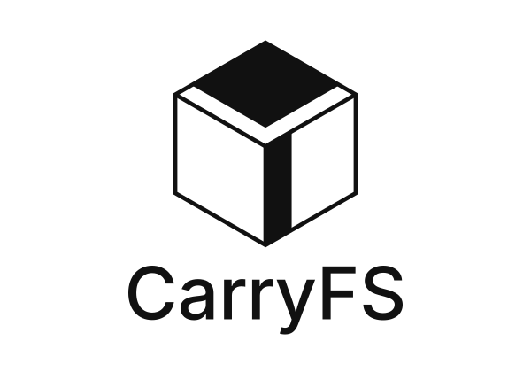
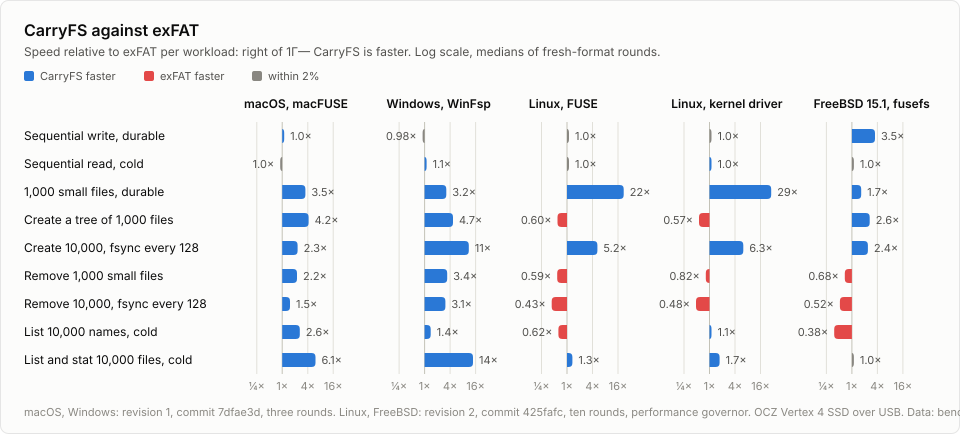

<h1 align="center">
  <picture>
    <source media="(prefers-color-scheme: dark)" srcset="assets/logo-dark.svg">
    
  </picture>
</h1>

<p align="center"><b>Your files, across macOS, Linux, FreeBSD, NetBSD, and Windows.</b></p>

<p align="center">
  <a href="https://github.com/carry-fs/carryfs/releases"></a>
  <a href="https://github.com/carry-fs/carryfs/actions/workflows/ci.yml"></a>
  <a href="#current-status"></a>
  <a href="LICENSE"></a>
  
</p>

CarryFS is an open-source filesystem for sharing data across operating systems,
with copy-on-write storage and built-in checksums.

## Install

First install the [framework for your platform](INSTALLATION.md#requirements).

Linux, macOS, FreeBSD, and NetBSD:

```sh
curl -fsSL https://carryfs.com/install.sh | bash
```

Windows, from 64-bit PowerShell:

```powershell
irm https://carryfs.com/install.ps1 | iex
```

### From source

Set up the [build requirements](CONTRIBUTING.md#build-requirements), then:

```sh
git clone https://github.com/carry-fs/carryfs.git
cd carryfs
./install.sh --local
```

On Windows, replace the last command with:

```powershell
powershell -ExecutionPolicy Bypass -File .\install.ps1 -Local
```

See [INSTALLATION.md](INSTALLATION.md) for setup, version selection, and
uninstall instructions. [FORMATTING.md](FORMATTING.md) explains how to prepare
a disk.

## What CarryFS does

CarryFS is for USB drives, external SSDs and hard disks, and data partitions
shared between operating systems. It supports files, directories, and symbolic
links, with case-insensitive names that preserve their capitalization.

CarryFS writes changes to new blocks, so the last committed state survives an
interrupted write as long as the device honors flushes. Checksums detect
corrupted file data and metadata, and `carryfs scrub` verifies every stored
file. CarryFS cannot repair damaged file data, so restore it from a backup. For
damaged metadata, see [offline diagnosis, repair, and recovery](RECOVERY.md).

CarryFS runs in user space through FUSE on Linux and FreeBSD, macFUSE on
macOS, WinFsp on Windows, and perfused and PUFFS on NetBSD. Linux also has a
native kernel driver. On Android, an app reads the USB drive itself.
[Platform support](INSTALLATION.md#platform-support) ranks each platform by
tier. Read the [limits and data safety notes](INSTALLATION.md#limits-and-data-safety)
before you keep backups on CarryFS.

## Performance

The chart shows CarryFS speed relative to exFAT, as medians of ten rounds on
an OCZ Vertex 4 SSD connected over USB. Your hardware and workload will give
other numbers. The [benchmark notes](benchmarks/README.md#published-results)
have the method, the raw results, and comparisons with native filesystems.

<picture>
  <source media="(prefers-color-scheme: dark)" srcset="benchmarks/charts/vs-exfat-dark.svg">
  
</picture>

## Current status

CarryFS is in **public beta**. Keep independent backups and never store the
only copy of important data on CarryFS. Unsynchronized changes can be lost
when a device is unplugged or power fails.

The current disk format is revision 2. A future format change may require
copying files elsewhere and reformatting the partition.

When you report a problem, include your operating system, the output of
`carryfs --version`, the storage device, and what you were doing. See
[CONTRIBUTING.md](CONTRIBUTING.md) for development setup and checks, and
[FORMAT.md](FORMAT.md) for the disk format.

## License

CarryFS is dual-licensed under **Apache-2.0 OR GPL-2.0-only**, at your option.
See [LICENSE](LICENSE). The bundled Unicode data retains its own
[license](testdata/unicode/16.0.0/LICENSE.txt).
