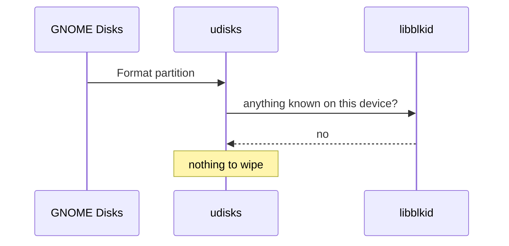
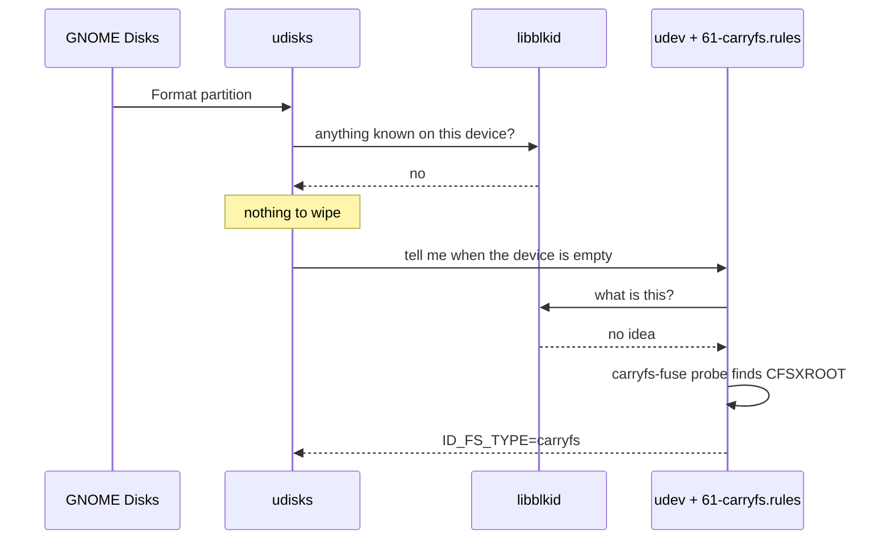
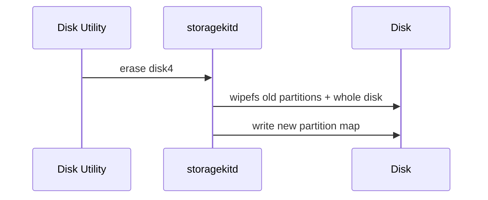
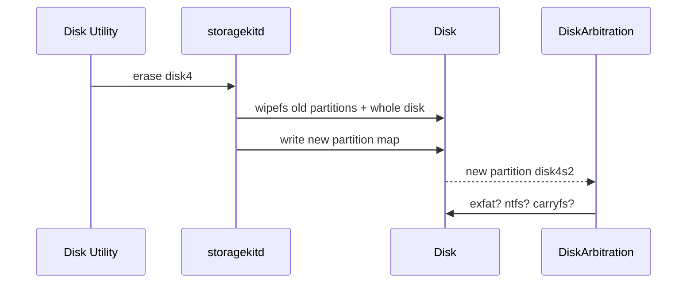
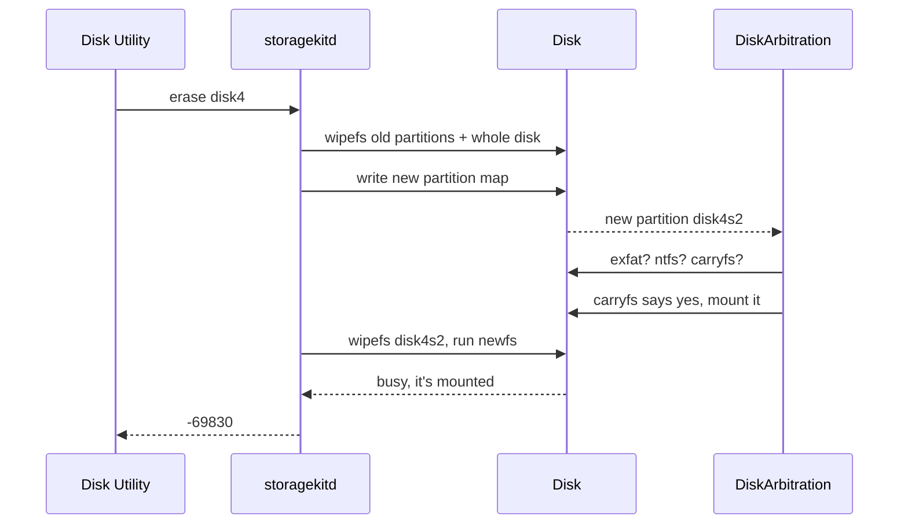

# What happens when you press Format

Every operating system has a Format button. You pick a name and a filesystem, you click, and a few seconds later the drive is empty. Nobody thinks about those few seconds. We had to, because CarryFS kept surviving them.

Here is what we found on Linux and on macOS. Format doesn't erase a disk. It erases the parts of a disk that the operating system expects to matter. A brand-new filesystem is a stranger, and each system treats strangers badly in its own way. Linux ignores them. macOS bulldozes them, but only after shaking their hand first.

## Where CarryFS keeps the parts that matter

CarryFS splits a partition into 4 KiB blocks. Two kinds of structure decide whether a partition counts as CarryFS.

The **roots** say where everything else is. There are two identical copies, so a crash in the middle of a write always leaves one good copy. Root A is at block 256, 1 MiB into the partition. Root B is 257 blocks before the end. Both start with the bytes `CFSXROOT`.

The **workspace banks** hold the list of spare blocks that CarryFS writes new metadata into. There are two banks, and they take turns. Each save writes the new list into the bank that isn't in use, then points the root at it. Bank A is at block 32, 128 KiB in. Bank B is 96 blocks before the end.

All four live inside a 2 MiB reserved band at each end of the partition. Your files live in the middle.

```
partition start                                                       partition end
|<------- 2 MiB band ------->|                         |<------- 2 MiB band ------->|
[    bank A        root A    ]  . . . your files . . . [    root B        bank B    ]
     128 KiB       1 MiB                                 end - 1028 KiB  end - 384 KiB
```

CarryFS has two ways to recognise itself, and both come up below.

- `has_root_magic` in `src/volume.rs` is the quick check. It looks for `CFSXROOT` at root A or root B and nothing else.
- `Volume::open` is the full check. It reads a root, then reads the bank that root points to. If that bank is zeroed, the open fails.

## Linux erases only the filesystems it recognises

When you press **Format** in GNOME Disks, the request goes to udisks. Before it creates the new filesystem, udisks calls `bd_fs_wipe` from libblockdev to clear whatever was on the device. The heart of it is this loop, from [libblockdev 3.5.0](https://github.com/storaged-project/libblockdev/blob/3.5.0/src/plugins/fs/generic.c#L487-L497):

```c
while (all && (blkid_do_probe (probe) == 0)) {
	status = blkid_do_wipe (probe, FALSE);
	...
}
```

`blkid_do_probe` asks libblkid whether the device carries a signature it knows. `blkid_do_wipe` zeroes that signature's bytes. The loop repeats until libblkid finds nothing. It's thorough, but only as thorough as libblkid's list of what exists.

That list is the `idinfos` array in [`libblkid/src/superblocks/superblocks.c`](https://github.com/util-linux/util-linux/blob/v2.42.3/libblkid/src/superblocks/superblocks.c#L95-L185). In util-linux 2.42.3 it has 82 entries. It knows ext4, Btrfs, ZFS, and APFS. It knows Xenix. It knows NetWare. It knows the filesystem from BeOS. It doesn't know CarryFS. So the loop finds nothing to wipe, wipes nothing, and udisks moves on.



Next, udisks waits for udev to confirm that the device is empty. udev runs libblkid, which again finds nothing. Then our own udev rule runs. `fuse/packaging/61-carryfs.rules` calls `carryfs-fuse probe` on every block device that libblkid left unlabelled. The probe calls `has_root_magic`, finds `CFSXROOT` at 1 MiB, and sets `ID_FS_TYPE=carryfs`. The wipe never touched that block, so the probe is right. The device still holds CarryFS.



udisks wants the device empty, and it never becomes empty. After 20 seconds it gives up:

```
udisksd: Error synchronizing after initial wipe: Timed out waiting for object
```

Nothing on the disk changed. The desktop mounts the CarryFS volume again, with every file still on it. In fairness to Linux, half of this one is our fault. Linux walked past the stranger, and our udev rule kept shouting that the stranger was still there. [Issue #7](https://github.com/carry-fs/carryfs/issues/7) has the full report.

### The fix: `mkfs.carryfs --wipe`

Since nothing else on Linux can erase CarryFS, CarryFS erases itself:

```sh
mkfs.carryfs --wipe /dev/sdX1
```

It zeroes both 2 MiB reserved bands with `erase_reserved_bands`. That removes both roots and both banks. Now libblkid, the udev probe, and udisks all agree that the device is empty, and GNOME Disks formats it as anything you like.

Two guards keep it from doing damage. It refuses a device without CarryFS roots, so a typo in the device name can't erase the start of someone else's filesystem. It also refuses a whole disk that holds partitions, because the partition table isn't its to erase.

Issue #7 is still open, because GNOME Disks can't do any of this on its own. The real fix is to add CarryFS to libblkid's list, the way ZFS and Btrfs are listed. Then the loop above would find CarryFS and wipe it like everything else.

### How Linux hides a volume without meaning to

Libblkid does know partition tables. So `wipefs -a /dev/sdX` on the whole disk erases the GPT and leaves the CarryFS volume inside it untouched. The volume is still there, but nothing on the disk points to it any more. Repartitioning in GNOME Disks or parted has the same effect. Keep that hidden volume in mind. It's what breaks macOS.

## macOS erases fixed regions, whatever they hold

Apple took the opposite approach. Apple's `wipefs`, in [libutil](https://github.com/apple-oss-distributions/libutil/blob/main/wipefs.cpp), doesn't ask what's on the device. It zeroes a fixed set of regions on every device it's given: the first and last 2 MiB, 64 KiB around the middle for NTFS, the UDF anchor blocks, and the sectors that hold partition tables. The source explains the 2 MiB part:

> we don't know what blocks future FS will use to recognize itself. But we'd better be safe than sorry and write the first and last 2MB of the volume

That's exactly where CarryFS keeps its roots and banks. Every Apple formatter calls `wipefs` on its target before writing anything. That includes `newfs_msdos`, `newfs_exfat`, `newfs_hfs`, and `newfs_apfs`. So macOS does erase CarryFS without knowing it exists. Erasing things it doesn't know about is the whole point of that code.

So we were surprised when Disk Utility failed to erase a stick:

```
Formatting disk4s2 as CarryFS with name YA TVOYA SHALAWA
This operation requires an unmounted disk. : (-69830)
```

The cause is the order in which macOS does things.

### The erase sequence

Disk Utility hands the erase to a system daemon, `storagekitd`. For a whole-disk erase, it does this:

1. It unmounts every volume on the disk.
2. It runs `wipefs` on every partition in the current table, and on the whole disk.
3. It writes the new partition map.
4. The kernel creates the new partition devices. DiskArbitration probes each one immediately with every installed filesystem, and mounts the first match.
5. `storagekitd` runs `wipefs` on the new partitions and runs the formatter.
6. If step 4 mounted something, step 5 refuses to format a mounted partition, with `-69830`.



Writing the map makes the kernel announce new partitions. DiskArbitration doesn't wait for `storagekitd` to finish.



CarryFS registers its probe, `carryfs.util -p`, with probe order 6000, so it runs after Apple's own checks. If it says yes, DiskArbitration mounts the partition. Then `storagekitd` reaches step 5.



We timed the gap between steps 4 and 5. A script polled the new partition every 5 ms during the erase. The old data stayed readable for 480 to 650 ms after the partition appeared, before the wipe in step 5 reached it. That gap is half a second in which macOS checks for a filesystem it's about to erase.

### Why this usually doesn't matter

In step 2, `storagekitd` wipes every partition in the current table. If the old CarryFS partition is in the table, it loses both bands before the new map exists, and the probe in step 4 finds nothing. We erased CarryFS into exFAT, HFS+, and CarryFS again, on GPT and on MBR. Every erase worked.

The problem is the hidden volume from the Linux section. The table doesn't mention it, so step 2 doesn't wipe it. Disk Utility then lays out a GPT disk the same way every time: a 200 MiB EFI partition, then the data partition from 201 MiB to the end. If the hidden volume came from that same layout, the new partition lands exactly on top of it. Same start, same size. CarryFS checks both, and both match.

### The 4 KiB near miss

Step 2 does wipe the whole disk, which covers the disk's first and last 2 MiB. On our 62 GB Lexar stick, the data partition ends exactly 1 MiB before the end of the disk. So the whole-disk wipe reaches 1 MiB into the end of the partition.

```
                     disk end - 2 MiB                       partition end   disk end
                            |                                      |            |
   ...  [ root B ]          |    [ bank B ]                        |            |
                            |<============ whole-disk wipe ====================>|
        ^ end - 1028 KiB         ^ end - 384 KiB
```

Bank B, at 384 KiB before the end of the partition, falls inside the wipe. Root B, at 1028 KiB before the end, misses it by one block, 4 KiB. Root A and bank A are 201 MiB into the disk, nowhere near either edge.

So when DiskArbitration probes the hidden volume, both roots are intact. Whether the probe passes depends on which bank the root points to, and the banks take turns.

- If the root points at bank B, the probe follows it to a zeroed bank. `Volume::open` fails, nothing gets mounted, and the erase works.
- If the root points at bank A, everything the probe needs is intact. It passes, macOS mounts a volume it's in the middle of erasing, and the erase fails with `-69830`.

A used CarryFS volume can be on either bank. We built hidden volumes on purpose and erased them. Every bank-A volume came back, 3 times out of 3. Bank-B volumes never did, in more than a dozen erases. So every erase of a hidden CarryFS volume is a coin flip, and the coin is whichever bank the last save happened to use.

### The workaround: erase again

The failed erase leaves the revived partition in the table. The second erase wipes it in step 2, and it works. [Issue #9](https://github.com/carry-fs/carryfs/issues/9) tracks a real fix. The options are adding CarryFS to libblkid, which stops Linux from hiding volumes in the first place, or storing the partition's GPT GUID in the root so a probe can tell a leftover from a live volume.

We haven't tested whether a hidden exFAT or APFS volume gets revived the same way. It probably does, since step 4 doesn't care which filesystem it finds. Those filesystems just rarely end up hidden, because every tool on Linux recognises them and wipes them.

## What we took away

Linux erases by name. If libblkid doesn't recognise a signature, nothing on Linux will erase it. A new filesystem has to bring its own eraser until it gets onto the list.

macOS erases by position. Fixed 2 MiB regions at each end catch almost anything, including filesystems that didn't exist when the code was written. But macOS checks for a filesystem before it wipes the new partition, so leftovers in exactly the right place get one chance to answer.

CarryFS keeps copies at both ends of the partition so a crash at either end can't lose the volume. That same choice makes it hard to erase. Any tool that wipes one end leaves a complete volume at the other.

All of the macOS measurements come from one 62 GB stick on macOS 15.6. The 4 KiB near miss depends on where the partition ends relative to the disk, so other disk sizes can behave differently.
