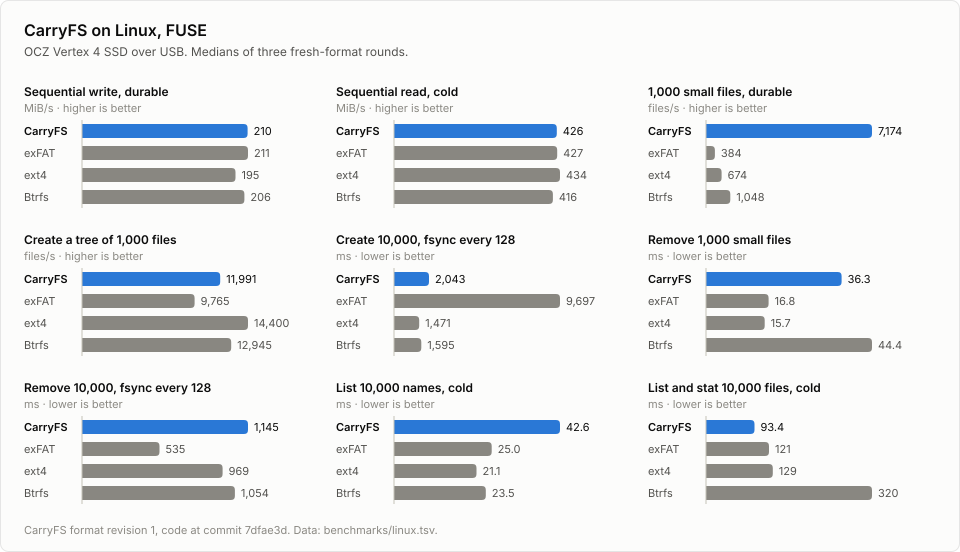
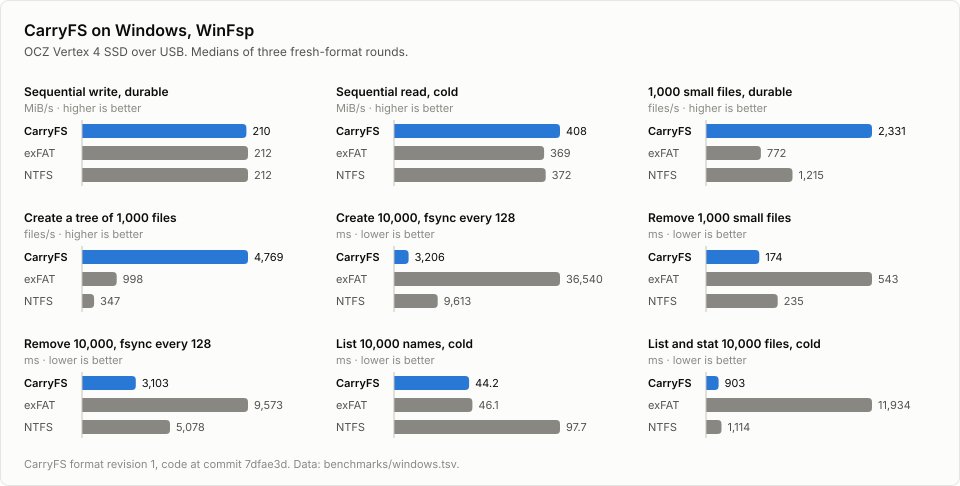
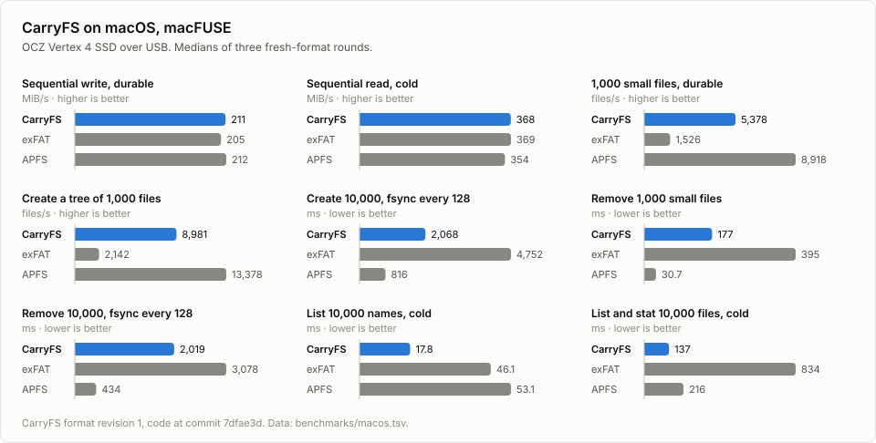

# Filesystem benchmarks

`run.py` builds CarryFS, checks the targets you picked, runs one workload on
each filesystem, and compares saved results. It runs on Linux, macOS and
Windows with the same workload and metric names, so you can compare CarryFS
with exFAT, ext4, Btrfs, APFS or NTFS on your own drive.

Every sample formats its target. Use disposable images or a disk whose
contents you can lose.

## Files

```text
benchmarks/
  run.py                    command line
  full.py, focused.py       the suite, and running one metric of it
  native.py, native_io.py   macOS and Windows mounting and flushing
  mount.rs                  source of the Linux user-mount helper
  workloads/                file operations, usable on any mounted filesystem
  chart.py                  SVG charts of saved results
  example*.json             host profiles and a chart config to copy and edit
  *.tsv                     published results of full runs
  charts.json, charts/      the charts of those results and their config
```

The Python code uses only the standard library.

## Requirements

Run every command from the repository root, in a Git checkout. You need
Python 3.11 or later and Rust with Cargo. On macOS, check `python3 --version`,
because `/usr/bin/python3` can be older. On Windows, use `py -3` wherever the
examples say `python3`.

The runner installs nothing. Install what your selected filesystems need:

| Host | Tools and access |
|---|---|
| Linux | util-linux (`lsblk`, `findmnt`, `mount`, `umount`, `wipefs`, `losetup`), and `udevadm` for images |
| Linux, CarryFS | FUSE with `/dev/fuse`, and `fusermount3` for user mounts |
| Linux, exFAT | `mkfs.exfat` and `fsck.exfat` from exfatprogs |
| Linux, ext4 or Btrfs | e2fsprogs or btrfs-progs |
| macOS | `diskutil`, `hdiutil`, `umount`, and [macFUSE](https://macfuse.github.io/) for CarryFS |
| Windows | PowerShell, `diskpart`, `chkdsk`, an elevated terminal, and [WinFsp](https://winfsp.dev/) for CarryFS |

## Quick start with images

Images need no spare disk. The runner creates them inside the results
directory.

```sh
cargo fetch --locked
python3 benchmarks/run.py build --out build/bench-binaries
python3 benchmarks/run.py plan --images --systems carryfs exfat \
  --bin-dir build/bench-binaries/release
sudo python3 benchmarks/run.py run --images --systems carryfs exfat \
  --bin-dir build/bench-binaries/release --out build/full-images
python3 benchmarks/run.py summary build/full-images
```

`cargo fetch` needs the network once. After that `build` works offline. Build
as your normal user. `build` and `run` refuse an output directory that already
exists, so pick a new path each time.

Linux needs `sudo` for loop devices and mounts. Windows needs an elevated
terminal. macOS mounts images as your user, so leave `sudo` out.

`--systems` picks the filesystems. Linux supports `carryfs`, `exfat`, `ext4`
and `btrfs`. macOS supports `carryfs`, `exfat` and `apfs`. Windows supports
`carryfs`, `exfat` and `ntfs`. `--size-mib` sets the image size, 1024 by
default. `--rounds` sets how many times each filesystem runs, 3 by default.

Run one benchmark at a time and keep the host otherwise idle. The runner takes
a host lock and refuses a second run.

## Commands

| Command | What it does |
|---|---|
| `build --out DIR [--source PATH]` | Builds the CLI and the platform adapter into a new directory and records their hashes in `build.json`. `--source` builds another checkout without changing it. |
| `plan` | Runs every preflight check and prints the plan as JSON. It writes nothing. |
| `run` | Repeats the preflight, then formats, mounts, measures, verifies and checks each target. |
| `metrics` | Lists metric names, units and phases. |
| `summary RUN` | Prints the Markdown table of a finished run. |
| `compare BASE CANDIDATE` | Prints the change between two finished runs. |

`plan` and `run` take the same options. Pass `--out` to `plan` to check the
output path as well.

On Linux, `build` also builds `carryfs-bench-mount` from `mount.rs` and the
checkout's FUSE adapter sources. User-mode runs mount CarryFS with it.

## Preflight

`run` checks every selected target before it creates results or formats
anything. `plan` runs the same checks alone.

The checks cover:

- Host tools, formatters and checkers for the selected filesystems, and Git.
  A missing tool is reported with its purpose and a package hint.
- The built CarryFS executables and the host driver, when CarryFS is selected.
- The profile, the workload size against the target's capacity, and each
  partition's identity.
- Device guards. The runner refuses whole disks, EFI and boot partitions,
  mounted or read-only targets, and disks that back system volumes. Linux also
  checks swap and system-device ancestry. macOS targets must be external
  disks. Windows requires GPT.
- Mount directories, which must be empty and must not hide the source,
  binaries or results.
- Access to partitions and `/dev/fuse`, and a new output path with a writable
  parent.

Run `plan` with the same user and elevation as `run`. An ordinary user can
read a root-mode plan, but its JSON reports the access checks as deferred.

Preflight does not mount anything, so it cannot promise that mounting will
succeed or that space will last. Those failures leave an incomplete run with
its logs.

## Benchmark a real disk

You prepare partitions and a profile once. The runner formats the selected
partitions before every sample, so you do not format them yourself. It never
creates or resizes partitions.

Allow at least 1 GiB for each partition with the default workload.
`--format-devices` is required for a physical run. It states that you accept
the erase.

### Linux

1. Create test partitions on a replaceable disk.
2. Copy the profile and edit it:

   ```sh
   cp benchmarks/example.json build/my-disk.json
   ```

   Set each `device` to a stable `/dev/disk/by-id/...-partN` path and each
   `mount` to its own directory, such as `/mnt/bench-carryfs`. Keep only the
   filesystems you want.
3. Set `"mount_mode": "root"` and run with `sudo`. The runner creates missing
   mount directories.
4. Check, then run:

   ```sh
   sudo python3 benchmarks/run.py plan --config build/my-disk.json \
     --bin-dir build/bench-binaries/release
   sudo python3 benchmarks/run.py run --config build/my-disk.json \
     --bin-dir build/bench-binaries/release \
     --format-devices --out build/my-disk-full
   python3 benchmarks/run.py summary build/my-disk-full
   ```

`"mount_mode": "user"` runs without `sudo`. It mounts CarryFS through
`fusermount3`, and it needs you to arrange three things first: write access to
the partitions, a CarryFS mount directory you own, and `user` or `users`
entries in fstab for the native filesystems at the same mount paths. The
runner does not edit fstab or udev rules.

### macOS

Use an external disk with GPT partitions. Copy
[example-macos.json](example-macos.json) to `build/my-mac.json`.

For each target, set `device` to the physical partition, such as
`/dev/diskNsM`, and `partition_uuid` to the `DiskUUID` that
`diskutil info -plist DEVICE` prints. Disk numbers change when you reconnect a
disk, so check them before each run. Use empty mount directories under
`/Volumes/`. Unmount the selected volumes before `plan`.

APFS needs its own partition. An existing APFS container must have one
physical store and exactly one volume. For an APFS target, give the physical
store's path and GPT UUID, not the synthesized volume's.

```sh
sudo python3 benchmarks/run.py plan --config build/my-mac.json \
  --bin-dir build/bench-binaries/release --out build/mac-full
sudo python3 benchmarks/run.py run --config build/my-mac.json \
  --bin-dir build/bench-binaries/release \
  --format-devices --out build/mac-full
```

Use `"mount_mode": "root"` with `sudo`. `"mount_mode": "user"` needs no
`sudo` once the partitions' `/dev/diskNsM` and `/dev/rdiskNsM` nodes belong to
you. `sudo chown` does that, and you repeat it after each reconnect.

A root run turns Spotlight indexing off on each freshly formatted native
volume, because indexing blocks unmounts. A user run cannot, so it leaves a
`.metadata_never_index` file in the volume root and retries the first unmount
for up to 30 seconds.

### Windows

Use a GPT disk and give CarryFS, exFAT and NTFS a partition each. The CarryFS
formatter refuses a partition that holds a native Windows filesystem.
Partitions made on Linux or macOS have types Windows does not mount. Change
them in this order from an elevated PowerShell:

```powershell
Set-Partition -DiskNumber N -PartitionNumber P -GptType '{ebd0a0a2-b9e5-4433-87c0-68b6b72699c7}'
Set-Partition -DiskNumber N -PartitionNumber P -NoDefaultDriveLetter $true
Set-Partition -DiskNumber N -PartitionNumber P -IsHidden $true   # CarryFS partitions
```

Remove any drive letter with `Remove-PartitionAccessPath`, because `plan`
refuses lettered partitions. Copy
[example-windows.json](example-windows.json), then fill in
`\\.\HarddiskNPartitionP` and each `partition_uuid` from
`(Get-Partition -DiskNumber N -PartitionNumber P).Guid`. Each `mount` is an
unused drive root such as `R:\`.

Stop the CarryFS service before a run with `Stop-Service CarryFS`, and start
it again afterwards. A full run on one disk can take more than an hour, so
start it with `Start-Process` to survive a closed terminal.

### Profile fields

Top level:

| Field | Meaning |
|---|---|
| `rounds` | Samples for each filesystem, 3 by default. `--rounds` overrides it. |
| `mount_mode` | `root` or `user`, as described for each host above. |
| `native_ro` | `true` mounts native filesystems read-only in the RO phases. `false` leaves them read-write. Linux needs root mounts for `true`. Windows supports it for images only. |
| `latency` | `true` records the time of every batch barrier, like `--latency`. |
| `workload` | Optional sizes: `seq_mib`, `files`, `dirs`, `per_dir`, `many_files`, `batch`, `stale_seconds`. |
| `disks` | A list of disks, each with a `name` and a `filesystems` list. |

Each `filesystems` entry:

| Field | Meaning |
|---|---|
| `fs` | `carryfs`, `exfat`, `ext4`, `btrfs`, `apfs` or `ntfs`, as the host supports. |
| `device` | The partition: a Linux path, macOS `/dev/diskNsM`, or Windows `\\.\HarddiskNPartitionP`. |
| `mount` | An empty absolute mount directory, or an unused drive root on Windows. |
| `partition_uuid` | The GPT partition UUID. Required on macOS and Windows, and checked before formatting. |
| `name` | Optional column name, the filesystem by default. Names must be unique. |
| `bin_dir` | Optional CarryFS binaries for this target. The default is `--bin-dir`. |

Disks run in list order. Filesystem order rotates each round. Native
filesystems can take turns on one partition, except APFS, which needs its own.

To compare two CarryFS builds in one run, add two `carryfs` targets with
different `name` and `bin_dir` values. They can share a partition. A rotated
run like this controls for drift better than two separate runs.

## What the suite measures

The default is three rounds of:

- A 512 MiB sequential write, its flush, and the combined durable throughput.
- 1,000 files of 4 KiB with a flush for each file and directory, and a tree of
  20 directories with 50 files each.
- 10,000 files of 4 KiB with a directory flush every 128 files and at the end.
- A first and a warm 512 MiB read, on separate read-write and read-only
  mounts.
- Three ways to list a directory of 1,000 and of 10,000 files: names only,
  list then stat, and stat interleaved with the listing. Each runs on its own
  fresh mount as a first pass, an immediate second pass, and a `stale` pass
  after 1.5 s, on read-write and read-only mounts.
- Durable removal, including the 10,000 files in batches of 128.
- Mount and unmount times.

After the timed work, the runner remounts, verifies SHA-256 hashes and the
namespace against a manifest, and checks the filesystem: CarryFS `check` and
`scrub`, `e2fsck -fn`, `fsck.exfat -n`, a read-only Btrfs check,
`diskutil verifyVolume`, or `chkdsk` without repair flags. Nothing is
repaired. Verification runs outside the timed regions.

Points to know when you read the numbers:

- `sequential_write` stops before the flush, so it can measure data entering
  RAM faster than the disk can take it. `fsync_after_write` is the flush.
  `sequential_write_durable` divides the payload by both times. Compare
  filesystems on the durable metric.
- A file flush is `fsync` on Linux, `F_FULLFSYNC` on macOS and
  `FlushFileBuffers` on Windows. A directory flush is `fsync` on Linux and
  macOS. Windows flushes the whole volume instead, which is stronger and can
  cost more.
- The batch metrics flush directories, not each file. A clean remount then
  verifies the data, which does not prove that file data would survive a
  crash.
- A cold pass on Linux follows `sync` and `posix_fadvise(DONTNEED)` on the
  partition. macOS uses a fresh mount and keeps the host cache. Windows starts
  a fresh CarryFS session, and locks and dismounts a native volume. All three
  can keep the drive's own cache. The run records its cache policy.
- Mount and unmount rows time a command, or the CarryFS helper's exit. Linux
  learns of the exit through a pidfd. Other hosts poll, so they report a short
  time at the next of 3.5, 7.5, 15.5, 31.5 or 63.5 ms.
- The `stale` pass waits `stale_seconds`. It does not guarantee that every
  cache lifetime has expired.
- Device read bytes, write bytes and busy time exist on Linux only. Other
  hosts keep the rows with `n/a`. They cover the whole sample after
  formatting, including verification.
- Linux CarryFS samples record the daemon's resident memory and its peak
  before each unmount. Kernel page cache is not included.
- `--latency` adds p50, p95, p99 and maximum batch-barrier times. Runs with
  and without it cannot be compared.

A `workload` object in the profile changes the sizes. `stale_seconds` must be
at least 1.1. Metric names that contain counts follow the workload: with
`many_files: 2000` and `batch: 64`, the metric is
`create_2000_batch64_durable`.

## Run one metric

List the names, units and phases:

```sh
python3 benchmarks/run.py metrics
```

`--metric` runs that operation with its setup, its verification after a
remount, and the filesystem checks. This example compares durable sequential
write on images:

```sh
sudo python3 benchmarks/run.py run --images --systems carryfs exfat \
  --metric sequential_write_durable --rounds 3 \
  --bin-dir build/bench-binaries/release --out build/write-only
python3 benchmarks/run.py summary build/write-only
```

| Metric | What it runs | Phase |
|---|---|---|
| `small_file_create_durable` | 1,000 files of 4 KiB with file and directory flushes | `write` |
| `create_10000_batch128_durable` | 10,000 files of 4 KiB with batch directory flushes | `write` |
| `remove_10000_batch128_durable` | Removing a prepared 10,000-file directory in batches | `delete` |
| `sequential_read` | Reading a prepared payload | `ro-cold`, `ro-warm`, `rw-cold`, `rw-warm` |
| `list_10000_list-stat` | Listing then stat on a prepared 10,000-file directory | `ro` or `rw`, with `cold`, `warm` or `stale` |
| `batch_fsync_p99` | The p99 batch-barrier time | `write` or `delete` |

Pick a phase other than the default with `--phase`:

```sh
sudo python3 benchmarks/run.py run --images --systems carryfs exfat \
  --metric sequential_read --phase ro-cold \
  --bin-dir build/bench-binaries/release --out build/read-only
sudo python3 benchmarks/run.py run --images --systems carryfs exfat \
  --metric list_10000_list-stat --phase rw-stale \
  --bin-dir build/bench-binaries/release --out build/list-only
```

The selector works with a profile too. Add `--metric` to the `plan` and `run`
commands from the disk sections above.

A one-metric run starts from a filesystem that holds only the data that metric
needs, so its numbers differ from the full suite's. Compare one-metric runs
with matching one-metric runs. Mount and device-counter metrics exist only in
the full suite.

## Results

A run directory holds:

| File | Content |
|---|---|
| `summary.md` | The median and the range across rounds for every metric. |
| `results.tsv` | Every observation, one per row. It opens in a spreadsheet. |
| `metadata.json` | The workload, selection, source and binary hashes, devices, mount settings, cache and flush policies, and host state. |
| sample directories | Raw JSONL, `commands.log` and `daemon.log` for each sample. |

A failed run keeps its logs and stays incomplete. `summary` and `compare`
refuse it. Resuming a run is not supported.

```sh
python3 benchmarks/run.py summary build/full-images
python3 benchmarks/run.py summary build/full-images > build/full-table.md
python3 benchmarks/run.py compare build/full-base build/full-candidate
python3 benchmarks/run.py compare HOST_A_RUN HOST_B_RUN --allow-environment-diff
```

`compare` prints the percentage change of each median. Higher rates and lower
times are better. It refuses runs that differ in workload, metric selection,
media, latency setting or benchmark sources. A different host, disk, mount,
cache policy or flush policy needs `--allow-environment-diff`, which reports
each difference. A comparison across operating systems compares the whole
stack, not the filesystem code alone.

## Charts

`chart.py` draws SVG charts from the `results.tsv` of finished runs. It writes
a light and a dark file for each chart.

```sh
cp benchmarks/example-charts.json build/charts.json
python3 benchmarks/chart.py build/charts.json build/charts
```

The example reads `build/full-images/results.tsv` from the quick start. Edit
the copy for your own runs:

| Field | Meaning |
|---|---|
| `charts` | One chart for each run. It shows nine workloads with the median of the rounds for each filesystem. |
| `name` | The file name, before `-light.svg` and `-dark.svg`. |
| `system`, `subtitle`, `note` | The title, the line under it and the footer. Put the run's date and commit in `note`. |
| `results` | The run's `results.tsv`, relative to the repository root. |
| `columns` | The name shown on the chart, mapped to a label in `results.tsv`. A label is the `name` of a `filesystems` entry, or its `fs` when it has no name. |
| `comparison` | Optional. Draws the charts listed in its `charts` side by side as CarryFS speed relative to the `against` filesystem, on a log scale. |

A chart needs a full run. A run of one metric lacks the other workloads, and
`chart.py` stops with the samples it could not find.

## Published results

`linux.tsv`, `windows.tsv` and `macos.tsv` hold full runs on one OCZ Vertex 4
SSD connected over USB, with three rounds for each filesystem. `charts.json`
draws them into `charts/`. The charts show nine of the 92 metrics each run
records, and the `.tsv` files hold the rest:

```sh
python3 benchmarks/chart.py benchmarks/charts.json benchmarks/charts
```

<picture>
  <source media="(prefers-color-scheme: dark)" srcset="charts/linux-dark.svg">
  
</picture>

<picture>
  <source media="(prefers-color-scheme: dark)" srcset="charts/windows-dark.svg">
  
</picture>

<picture>
  <source media="(prefers-color-scheme: dark)" srcset="charts/macos-dark.svg">
  
</picture>

[charts/vs-exfat-light.svg](charts/vs-exfat-light.svg) compares CarryFS with
exFAT on the three hosts in one chart.

## Workloads on a mounted filesystem

The scripts in `workloads/` take a filesystem you mounted yourself. They skip
the preflight, formatting and mounting that `run.py` does, and they print TSV
rows of label, phase, metric, value and unit.

```sh
python3 benchmarks/workloads/bench.py MOUNT LABEL --phase write
python3 benchmarks/workloads/bench.py MOUNT LABEL --phase read
python3 benchmarks/workloads/listing.py DIRECTORY list-stat
python3 benchmarks/workloads/mixed.py MOUNT LABEL --phase write --scale 0.1
```

| Script | Workload |
|---|---|
| `bench.py` | Sequential write and read, small files, a tree, and symlinks. Phases are `write`, `read` and `symlinks`. `--seq-mib`, `--files`, `--dirs` and `--per-dir` set the sizes. |
| `listing.py` | One listing pattern on a directory: `names`, `list-stat` or `interleaved`. It prints JSON. |
| `mixed.py` | A backup-like corpus of files from 1 KiB to 2 GiB, about 10.5 GiB and 5,139 files at `--scale 1`. Run the phases in order: `write`, `verify`, `update`, `verify`, `walk`, `delete`. It keeps its state in `build/mixed-state-LABEL.json`. Linux and macOS only. |
| `bench_win.py` | `bench.py` on Windows, with binary file modes and `FlushFileBuffers`. |
| `micro_win.py` | One Windows operation for each run: `create`, `stat`, `list`, `delete`, `tree`, `seqwrite` or `seqread`. |
| `win_scale.py` | A large Windows volume: `populate` creates a million small files by default, `age` fills, deletes and refills near capacity, and `sync` flushes the volume. |

Each script's `--help` or its header lists the options.

## Troubleshooting

- **Missing executable.** Run `build` first and pass its `release` directory
  as `--bin-dir`. `build.log` and `build-mount.log` are in the build output.
- **Missing command or access.** `plan` lists every missing command with a
  package hint. Install it, or use the elevation the profile needs.
- **Output directory exists.** Choose a new `--out` path.
- **A run failed.** Read `commands.log` and `daemon.log` in the failing
  sample's directory.
- **Comparison refused.** Check the metric and phase, workload, source hashes,
  media and latency settings of both runs.
